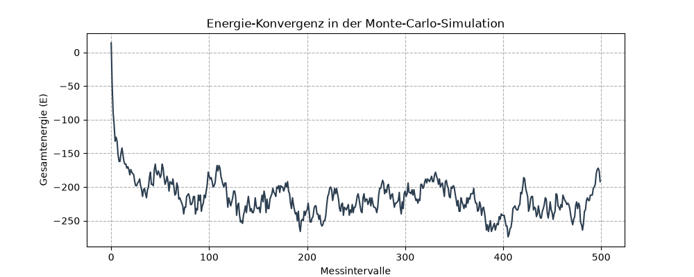

# Scientific Simulation: Monte Carlo Modeling of Microscopic Systems

[](https://www.python.org/)
[](https://numpy.org/)
[](https://matplotlib.org/)
[](https://jupyter.org/)
[](https://en.wikipedia.org/wiki/Condensed_matter_physics)

> A numerical simulation project implementing the Metropolis Monte Carlo algorithm to study thermal equilibrium and energy convergence in a 2D Ising-like lattice system.

## 📋 Table of Contents

- [Overview](#overview)
- [Key Features](#key-features)
- [Theoretical Background](#theoretical-background)
- [Technologies Used](#technologies-used)
- [Project Structure](#project-structure)
- [Installation](#installation)
- [Usage](#usage)
- [Results](#results)
- [Methodology](#methodology)
- [Future Improvements](#future-improvements)
- [License](#license)
- [Acknowledgments](#acknowledgments)

## 🔍 Overview

This project demonstrates the application of **stochastic numerical methods** to model microscopic interactions in condensed matter physics. Using the **Metropolis-Hastings algorithm**, it simulates the thermal behavior of a two-dimensional spin lattice system, tracking its evolution toward thermodynamic equilibrium as a function of temperature.

The simulation bridges the gap between microscopic physics and macroscopic observables, showcasing how random processes governed by statistical mechanics give rise to predictable system-wide behavior.

## ✨ Key Features

- **🔬 Stochastic Modeling** – Implements probabilistic state transitions based on Boltzmann statistics
- **⚛️ Ising Model Simulation** – Models nearest-neighbor spin interactions on a periodic lattice
- **🎯 Metropolis Algorithm** – Efficiently samples configuration space using the Metropolis criterion
- **🔄 Periodic Boundary Conditions** – Eliminates edge effects for accurate bulk behavior
- **📊 Real-time Energy Tracking** – Monitors system energy throughout equilibration
- **📈 Automated Visualization** – Generates convergence plots for energy analysis
- **⚡ Optimized with NumPy** – Leverages vectorized operations for computational efficiency

## 🧮 Theoretical Background

The simulation is based on the **2D Ising Model**, a classical model in statistical mechanics used to study phase transitions and magnetic behavior. 

### Metropolis Criterion

At each Monte Carlo step, a random spin is flipped, and the energy change $\Delta E$ is calculated. The transition is accepted with probability:

$$
P(\Delta E) = \begin{cases}
1, & \Delta E \le 0\\
\exp\left(-\frac{\Delta E}{k_B T}\right), & \Delta E > 0
\end{cases}
$$

For this simulation, we use units where $k_B = 1$. This criterion ensures the system samples configurations according to the canonical Boltzmann distribution, driving it toward thermal equilibrium.

## 🛠️ Technologies Used

| Technology | Purpose |
|------------|---------|
| **[Python 3.12](https://www.python.org/)** | Core simulation and analysis |
| **[NumPy](https://numpy.org/)** | Efficient array operations and numerical computations |
| **[Matplotlib](https://matplotlib.org/)** | Scientific plotting and visualization |
| **[Jupyter Notebook](https://jupyter.org/)** | Interactive development and result presentation |

## 📁 Project Structure

```plaintext
scientific-simulation-monte-carlo/
│
├── Monte-Carlo-Simulation.ipynb   # Main simulation notebook with full implementation
├── monte_carlo_convergence.png    # Generated energy convergence plot
└── README.md                      # Project documentation
```

## 🚀 Installation

### Prerequisites

- Python 3.12 or higher
- pip package manager

### Setup

1. **Clone the repository**

```bash
git clone https://github.com/dgoo24/scientific-simulation-monte-carlo.git
cd scientific-simulation-monte-carlo
```

2. **Install dependencies**

```bash
pip install numpy matplotlib jupyter
```

## 💻 Usage

1. **Launch Jupyter Notebook**

```bash
jupyter notebook
```

2. **Run the simulation**

   Open `Monte-Carlo-Simulation.ipynb` and execute all cells (`Cell > Run All`). The simulation will:
   
   - Initialize a random 20×20 spin lattice
   - Run 50,000 Metropolis Monte Carlo steps at temperature T = 2.5
   - Track and record system energy at regular intervals
   - Generate and display the convergence plot
   - Export `monte_carlo_convergence.png` automatically

## 📊 Results

### Energy Convergence



The plot above shows the system's total energy evolving over Monte Carlo steps. After an initial equilibration phase, the energy stabilizes, indicating the system has reached **thermal equilibrium**. This demonstrates the correct implementation of the Metropolis algorithm and its ability to converge to the canonical ensemble.

### Simulation Parameters

| Parameter | Value | Description |
|-----------|-------|-------------|
| **Lattice Size (N)** | 20 × 20 | 400 spins total |
| **Temperature (T)** | 2.5 | In units of $J/k_B$ |
| **Monte Carlo Steps** | 50,000 | Total update attempts |
| **Sampling Interval** | Every 100 steps | Energy measurement frequency |

## 🔬 Methodology

### 1. **System Initialization**
- Create a 2D square lattice with periodic boundary conditions
- Assign each site a random spin state: $s_i \in \{+1, -1\}$

### 2. **Energy Calculation**
- Compute total Hamiltonian using nearest-neighbor interactions:
  $$H = -J \sum_{\langle i,j \rangle} s_i s_j$$
- With $J=1$ for ferromagnetic coupling
- Account for periodic boundaries to maintain translational symmetry

### 3. **Monte Carlo Evolution**
- **Trial move:** Randomly select a lattice site and propose spin flip $s_i \rightarrow -s_i$
- **Energy change:** Calculate $\Delta E$ from the 4 nearest neighbors
- **Acceptance:** Apply Metropolis criterion based on $\Delta E$ and temperature
- **Update:** Accept or reject the move, record observables

### 4. **Analysis & Visualization**
- Sample system energy at fixed intervals to reduce correlation
- Plot convergence to assess equilibration time
- Save high-quality visualization for documentation

## 🔮 Future Improvements

- [ ] **Phase Transition Analysis** – Simulate across a range of temperatures to observe Curie temperature
- [ ] **Additional Observables** – Calculate magnetization, specific heat, and magnetic susceptibility
- [ ] **Larger Lattices** – Extend to larger systems with performance optimization
- [ ] **Finite Size Scaling** – Analyze critical behavior more accurately
- [ ] **Animation** – Visualize spin configurations evolving over time
- [ ] **Parallelization** – Implement multithreading for faster large-scale simulations
- [ ] **Data Export** – Save simulation data as CSV/NumPy arrays for post-processing

## 🙏 Acknowledgments

- Inspired by research conducted at the **Condensed Matter Laboratory (LMC)**
- Based on the classical Metropolis Monte Carlo method for statistical physics
- Special thanks to the foundations of computational condensed matter physics

---

**Note:** This project is developed for educational and scientific demonstration purposes, showcasing numerical methods in physics.
